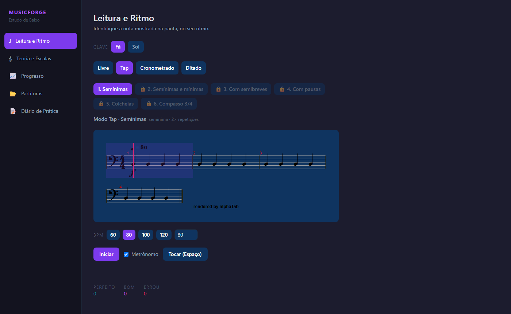
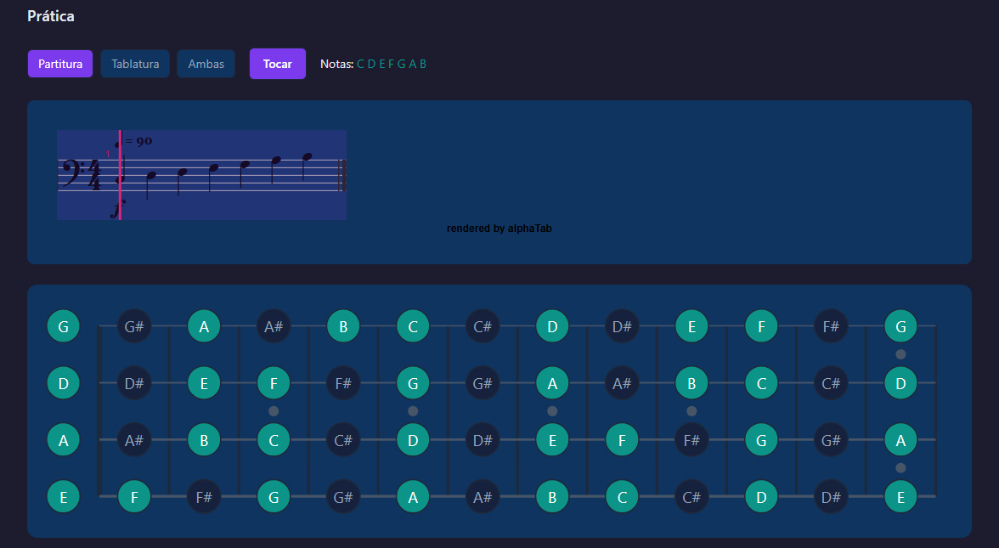

# Decifrae MusicForge — app desktop para estudar baixo

Aplicativo desktop (Windows e Linux) para o estudo individual de **baixo elétrico**: treino de
leitura de partitura e ritmo, teoria e escalas no braço do instrumento, editor de frases,
acompanhamento de progresso e diário de prática. É uma ferramenta de apoio ao estudo, não
substitui o instrumento. Faz parte do ecossistema [decifrae.com.br](https://decifrae.com.br).





## Funcionalidades

| Módulo | O que tem |
|---|---|
| **Leitura e Ritmo** | 4 modos (Livre, Tap com níveis e desbloqueio, Cronometrado, Ditado), gerador procedural de ritmo, clave de Fá e de Sol |
| **Teoria e Escalas** | escalas, modos, pentatônicas e blues na pauta e no braço com reprodução sincronizada; campo harmônico; editor de frases (grade rítmica + braço → partitura → reprodução); 12 textos teóricos originais |
| **Progresso** | progresso por exercício com gráfico e mapa de calor, revisão dos textos teóricos; trilha de livros e mapa de teoria em construção |
| **Diário de Prática** | cadastro de exercícios, registro de sessões (BPM, duração, autoavaliação, observação) e sugestão adaptativa do que praticar |
| **Partituras** | importação de MusicXML e Guitar Pro via AlphaTab (próximo módulo) |

Número de cordas e afinação são configuração, não constantes, para o app poder atender outros
instrumentos no futuro.

## Tecnologias

- **Tauri 2** (Rust + WebView) para o app desktop
- **React 19 + TypeScript**, **Tailwind CSS 4**, **Zustand** para o estado global
- **AlphaTab** para partitura e tablatura, com cursor controlado pelo app
- **Web Audio API** para a síntese do som; o relógio do áudio guia toda a temporização
- **SQLite** (`tauri-plugin-sql`) com migrações versionadas e fallback em memória no navegador
- **Teoria musical escrita à mão** (`note-utils.ts`, `theory-engine.ts`), sem biblioteca externa
- **Vitest + Testing Library**: 385 testes em 30 arquivos

A lógica fica em motores puros em `src/engine/` (sem React, áudio ou banco), o que permite
testar cada um isoladamente:

```
src/pages/, src/components/, src/hooks/   interface (React)
src/engine/                               motores puros: notas, teoria, leitura, ritmo,
                                          níveis, estatísticas, sugestão de prática
src/engine/audio-engine.ts                áudio (Web Audio API)
src/db/                                   persistência (SQLite)
src-tauri/                                casca desktop em Rust
```

## Como rodar

Requer Node.js 20.19 ou mais novo (exigência do Vite 7). Para o app desktop, também o
[Rust e os pré-requisitos do Tauri](https://tauri.app/start/prerequisites/).

```bash
npm install            # também copia os arquivos do AlphaTab para public/
npm run tauri dev      # app desktop
npm run dev            # versão web no navegador (sem SQLite, dados em memória)
npm test               # testes
npm run lint
```

## Documentação

| Documento | Conteúdo |
|---|---|
| [docs/project-brief.md](docs/project-brief.md) | visão do produto e os módulos planejados |
| [docs/ESTADO-DO-PROJETO.md](docs/ESTADO-DO-PROJETO.md) | o que foi feito por fase, decisões e o que falta |
| [docs/theory-content-source.md](docs/theory-content-source.md) | fonte dos textos teóricos |

## O que aprendi

- **Desenvolver por etapas:** cada função foi trabalhada até funcionar bem antes de seguir para a
  próxima, e cada fase ficou registrada com o que foi feito e por quê.
- **Testes unitários para cada etapa:** separar a lógica em motores puros tornou possível testar
  teoria, ritmo, níveis e sugestão sem abrir a interface.
- **Documentar as decisões:** os documentos de estado e de contexto permitem retomar o projeto
  depois de semanas parado sem perder o raciocínio.
